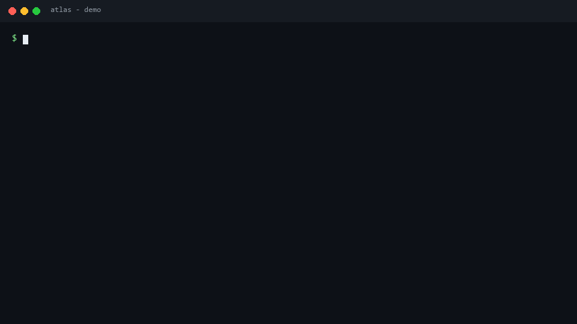

# Atlas docs

Benchmark documentation for **Atlas** — a CLI for measuring how accurately
models produce structured tool calls, in a mock sandbox (no real tool
execution, no side effects).

| Guide | What it covers |
|---|---|
| [Getting started](getting-started.md) | Install, first run, `doctor`, dry runs |
| [CLI reference](cli-reference.md) | Every subcommand and flag (`run`, `batch`, `list`, …) |
| [Batch & leaderboards](batch.md) | `atlas batch`: many models, one suite, ranked output |
| [Providers](providers.md) | Ollama, OpenAI-compatible, Anthropic, Gemini, dummy |
| [Scoring](scoring.md) | Axes, pass gates, reliability, error analysis |
| [Custom suites](custom-suites.md) | Writing suite JSON, matchers, alternatives, splits |
| [Robustness & safety](robustness.md) | Perturbations, scaling, safety, injection, closed-loop |
| [CI & regression](ci.md) | `--fail-under`, baselines, `diff`, GitHub Actions |
| [Architecture](architecture.md) | `src/` layout and where things live |
| [FAQ](faq.md) | Common questions |

Demos (regenerate with `python scripts/make_demos.py`):

